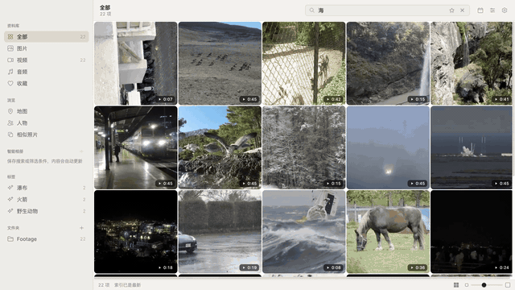
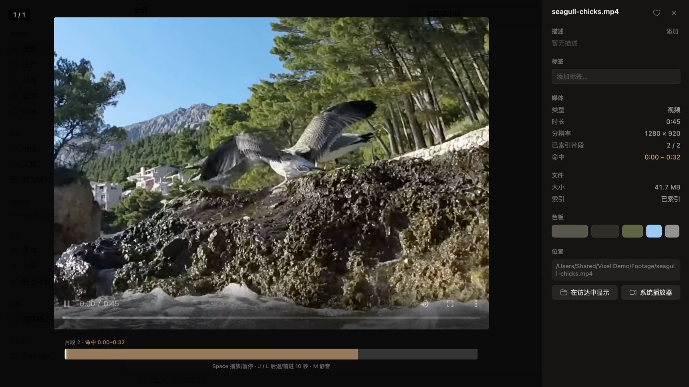

<div align="center">


# Vixel

**Find the moment in your photos and videos by describing it.**
Local AI search for photos, videos and audio. Fully offline, no account, nothing uploaded.

[中文](README.md) · English

</div>

<p align="center"></p>

> The interface is available in English and Simplified Chinese (follows your system language; change it in *Settings → General*). Search works in English, Chinese and 100+ other languages.

## What it does

- **Natural-language search across photos, video and audio.** One model, EmbeddingGemma 2, puts text, images, video segments and audio into the same multilingual vector space. "Dog barking on the beach" matches what is *seen* and what is *heard*.
- **Jump to the moment in a video.** Videos are split into 32-second segments (frames + audio encoded together); opening a result seeks to the matching segment and highlights it on the timeline.
- **Search text inside images and video frames.** Local PaddleOCR v5 reads screenshots, receipts, signs, whiteboards. Strong on Chinese and English.
- **People.** Face detection and clustering, with a quality gate so only confident matches are grouped automatically; merge, rename, hide.
- **Honest results.** Semantic, OCR and filename hits are fused with RRF, and a relevance gate decides whether anything really matches. If nothing does, Vixel says so instead of padding the page.
- **Favorites, filters and smart albums.** Press F to favorite; filter by orientation, resolution, duration or person on top of any search; save a search + filters as a smart album that stays up to date.
- **Clean up similar photos.** Finds burst shots, re-exports and lightly edited copies, suggests which one to keep, and hides the rest in Vixel or moves them to the Trash after you confirm.
- **Offline map, similar photos, de-duplication, HEIC / RAW, quick look, dark mode.**
- **CLI for scripts and agents:** `vixel search "sunset at the beach" --json`.



## Supported formats

| Type | Extensions |
|---|---|
| Images | jpg · jpeg · png · webp · gif · bmp · tiff · avif · heic · heif |
| RAW | cr2 · cr3 · nef · arw · dng · raf · orf · rw2 |
| Design | svg · psd · psb · pdf* · ai* (* macOS only; indexed via a raster preview, format badge in the grid) |
| Video | mp4 · mov · m4v · webm · mkv · avi |
| Audio | mp3 · m4a · aac · wav · flac · ogg · opus |

PSD/PSB are read from the file's merged composite (Photoshop's "Maximize Compatibility", on by default);
AI files must be saved with "Create PDF Compatible File". On Windows/Linux, PDF/AI are not indexed
(no lightweight renderer without a native canvas); EPS is unsupported everywhere (macOS removed
PostScript decoding).

## Compared with

| | Vixel | Eagle | Immich | Apple Photos |
|---|---|---|---|---|
| Price | Free, open source (MIT) | Paid (lifetime license) | Free, open source | Built in |
| How it works | Desktop app, indexes your existing folders in place | Desktop app, imports files into its own library | Self-hosted server (Docker) | Manages the Photos library only |
| Platforms | macOS · Windows | macOS · Windows | Server + web / mobile | Apple devices |
| Offline natural-language search | ✅ images · video segments · audio | ✅ images only (AI Search plugin) | ✅ on your server | ✅ |
| Text-in-image search | ✅ local OCR, incl. video frames | Plugin using a Google API | ✅ | ✅ |
| People | ✅ | — | ✅ | ✅ |

## Privacy

- **Offline, no exceptions.** All models ship inside the app and run on your machine; there is no first-run download. The basemap is bundled ([Natural Earth](https://www.naturalearthdata.com/)). Every network request from the UI is blocked in code.
- No account, no telemetry, no cloud. Original files are read-only; the index lives in the app's data folder.
- **Two notes about collecting** (since v0.4):
  - When you **drag an image from a browser** into Vixel and the drag carries only a URL (no image data), the main process downloads that one URL, once, at the moment you drop it (size/type limits and a timeout; the source is recorded under "Source"). This user-initiated, one-off fetch is the app's only outbound request; the UI's network allowlist stays empty.
  - The browser extension's local server is **off by default**; when enabled it listens on `127.0.0.1` only, requires a random pairing token, and **never makes outbound requests** — the extension fetches the image in the browser and hands Vixel the bytes.

## Download

[**Latest release**](https://github.com/RGB-loop/Vixel/releases/latest): macOS (Apple Silicon) `.dmg` and Windows (x64) `.exe`. Models are included (~600 MB).

The builds are not signed by Apple / Microsoft yet:

- **macOS:** if the first launch is blocked, open *System Settings → Privacy & Security* and click *Open Anyway*, or run `xattr -dr com.apple.quarantine /Applications/Vixel.app`.
- **Windows:** on the SmartScreen prompt, click *More info → Run anyway*.

GPU inference uses Metal on macOS and Direct3D 12 on Windows, falling back to CPU.

## Build from source

Node.js 20+.

```bash
npm install
npm run models:download   # EmbeddingGemma 2 (LiteRT) + LiteRT runtime + PaddleOCR, ~500 MB, once
npm run dev
npm run build && npm run package   # installers in release/
```

## How it works

| | |
|---|---|
| Embeddings | EmbeddingGemma 2 (768-d) via [LiteRT-LM](https://github.com/google-ai-edge/LiteRT-LM), C API called through koffi, in a separate low-priority process |
| Vector search | sqlite-vec `vec0` (images, media segments, faces) |
| Text search | PaddleOCR v5 + jieba + SQLite FTS5 |
| Fusion | image vectors + segment vectors + OCR + filename, Reciprocal Rank Fusion, adaptive relevance gate |
| Faces | SCRFD detection → alignment → MobileFaceNet → quality-gated clustering |
| App | Electron, React, Tailwind, better-sqlite3, sharp, ffmpeg |

More detail (in Chinese): [Vixel_Tech.md](Vixel_Tech.md), [docs/review/](docs/review/).

## License

[MIT](LICENSE). Sample photos in the screenshots are from [Immich test-assets](https://github.com/immich-app/test-assets) (public domain).
